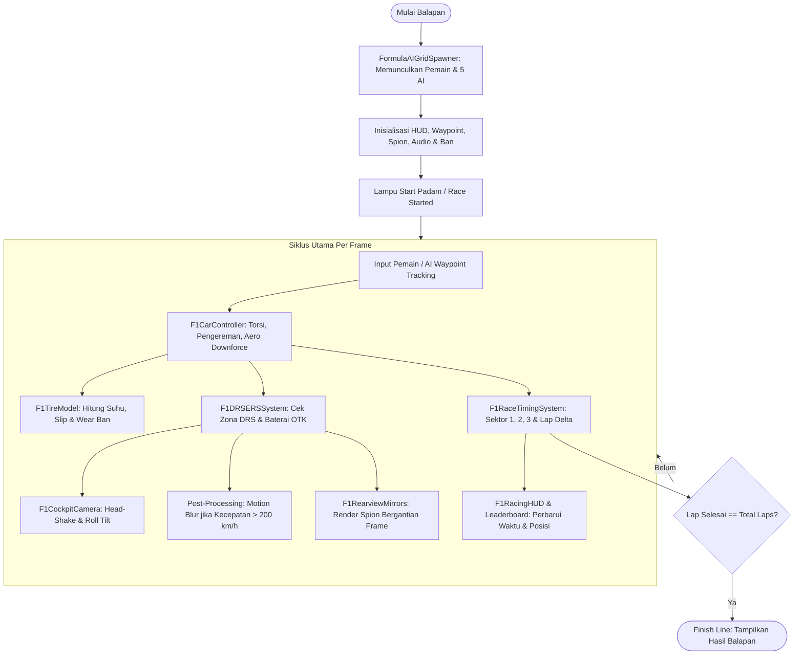

# 🏎️ FORMULA RACING MOBILE (APEX V12)

[](https://unity.com/)
[](https://unity.com/srp/Universal-Render-Pipeline)
[](https://unity.com/)
[](#)

> **Formula Racing Mobile (APEX V12)** adalah game simulasi dan arcade balap Formula 1 *single-seater* generasi modern berperforma tinggi yang dibangun di atas **Unity 6** menggunakan **Universal Render Pipeline (URP)**. Proyek ini dirancang khusus untuk menghadirkan sensasi balap jet darat yang otentik, responsif, dan memukau secara visual, baik pada perangkat sentuh mobile (Android/iOS) maupun PC desktop.

---

## 📑 Daftar Isi

1. [Ikhtisar Game (Overview)](#-ikhtisar-game-overview)
2. [Fitur-Fitur Utama](#-fitur-fitur-utama)
   - [1. Fisika Mobil & Transmisi 8-Speed](#1-fisika-mobil--transmisi-8-speed)
   - [2. Sistem DRS (ALA) & ERS Hybrid Boost (OTK / SET)](#2-sistem-drs-ala--ers-hybrid-boost-otk--set)
   - [3. Simulasi Ban 4-Roda & Suhu (F1 Tire Model)](#3-simulasi-ban-4-roda--suhu-f1-tire-model)
   - [4. AI Opponents Cerdas & Grid Balap](#4-ai-opponents-cerdas--grid-balap)
   - [5. Sirkuit Baku Street Circuit & Waypoint Spline](#5-sirkuit-baku-street-circuit--waypoint-spline)
   - [6. F1 Broadcast HUD & Kontrol Mobile](#6-f1-broadcast-hud--kontrol-mobile)
   - [7. Sistem Multi-Kamera & Sudut Kokpit Halo](#7-sistem-multi-kamera--sudut-kokpit-halo)
   - [8. Spion Belakang Real-Time (Dual Rearview Mirrors)](#8-spion-belakang-real-time-dual-rearview-mirrors)
   - [9. Audio Mesin V12 Turbo Bertekanan Tinggi](#9-audio-mesin-v12-turbo-bertekanan-tinggi)
   - [10. Grafis Golden Hour & Dynamic Post-Processing](#10-grafis-golden-hour--dynamic-post-processing)
   - [11. 3D Garage & Pemilihan Tim](#11-3d-garage--pemilihan-tim)
3. [Skema Kontrol (Controls)](#-skema-kontrol-controls)
4. [Tampilan Antarmuka (HUD Layout)](#-tampilan-antarmuka-hud-layout)
5. [Arsitektur Kode & Struktur Proyek](#-arsitektur-kode--struktur-proyek)
6. [Alur Balapan (Race Workflow Diagram)](#-alur-balapan-race-workflow-diagram)
7. [Panduan Instalasi & Menjalankan Game](#-panduan-instalasi--menjalankan-game)
8. [Editor Tools & Otomasi](#-editor-tools--otomasi)
9. [Optimasi Mobile (Android Performance)](#-optimasi-mobile-android-performance)

---

## 🏁 Ikhtisar Game (Overview)

**Formula Racing Mobile** menghadirkan pengalaman balap roda terbuka (*open-wheel formula racing*) dengan kombinasi sempurna antara aksesibilitas arcade yang menyenangkan dan kedalaman taktik telemetri Formula 1. 

Pemain bertarung melawan 5 AI rival di trek jalan raya menantang yang terinspirasi oleh **Baku City Circuit**, menampilkan trek lurus panjang tepi laut untuk adu *top speed* hingga 350+ km/h, dipadukan dengan seksi sempit kastil tua (*Old City*) yang menuntut pengereman presisi dan manajemen grip ban.

```
┌────────────────────────────────────────────────────────────────────────┐
│                        SPESIFIKASI MOBIL BALAP                         │
├──────────────────────┬─────────────────────────────────────────────────┤
│ Mesin / Powertrain   │ V12 Turbo Hybrid (~1000 HP / 735 kW)            │
│ RPM Operasi          │ Idle 3.500 RPM | Redline 15.000 RPM             │
│ Transmisi            │ 8-Speed Sequential (Instant 45ms Shift)         │
│ Kecepatan Puncak     │ ~350–360 km/h (Mencapai 370 km/h dengan DRS)    │
│ Aerodinamika         │ Dynamic Downforce + Ground Effect Undertray     │
│ Sistem Energi        │ 4000 kJ ERS Battery + Kinetic/Thermal Harvest   │
└──────────────────────┴─────────────────────────────────────────────────┘
```

---

## ⚡ Fitur-Fitur Utama

### 1. Fisika Mobil & Transmisi 8-Speed
* **Tiga Mode Suspensi Adaptif**:
  * `Arcade`: Perhitungan gaya berbasis Rigidbody yang sangat stabil untuk layar sentuh mobile.
  * `WheelCollider`: Simulasi ban fisik bawaan Unity untuk feedback ground interaction yang natural.
  * `Raycast`: Suspensi pegas dan peredam (*spring & damper*) berbasis raycast kustom untuk akurasi responsif.
* **Aerodinamika & Ground Effect**: Gaya tekan ke bawah (*downforce*) meningkat sebanding dengan kuadrat kecepatan ($v^2$). Ketinggian *ride height* yang semakin dekat ke aspal menghasilkan tambahan *downforce suction* efek tanah (*ground effect venturi*).
* **Transmisi 8-Percepatan**: Mendukung mode **Automatic** (otomatis upshift/downshift berdasarkan RPM optimal) dan mode **Manual** (perpindahan gigi instan melalui tombol paddle shift `+` dan `-`).

### 2. Sistem DRS (ALA) & ERS Hybrid Boost (OTK / SET)
* **DRS / ALA (Drag Reduction System)**:
  * Membuka flap sayap belakang saat berada di zona trek lurus untuk memangkas hambatan udara (*drag coefficient*).
  * Memberikan lonjakan kecepatan puncak hingga **+15 sampai 20 km/h**.
  * Dilengkapi fitur pengaman otomatis: flap DRS langsung menutup seketika saat pengemudi menginjak pedal rem.
* **ERS / OTK (Energy Recovery System & Overtake Boost)**:
  * Baterai berkapasitas 4.000 kJ yang dapat dideploy dengan tombol **OTK** untuk tenaga ekstra instan 120 kW (~160 HP) selama 8 detik.
* **Engine Modes (SET)**:
  * Pengemudi dapat mengubah pemetaan mesin (*Engine Maps*): **Conserve (Hemat)**, **Normal**, **Aggressive**, dan **Overtake**.
  * Pengisian ulang baterai (*Harvesting*) terjadi secara otomatis saat mobil meluncur bebas (*coasting*) dan melakukan pengereman regeneratif (*braking*).

### 3. Simulasi Ban 4-Roda & Suhu (F1 Tire Model)
Setiap ban (**Depan Kiri, Depan Kanan, Belakang Kiri, Belakang Kanan**) dihitung secara independen:
* **Termal Ban**: Suhu ban naik saat pengereman keras, akselerasi, dan *cornering* berkecepatan tinggi.
* **Grip Dinamis**: Koefisien cengkeraman ban berada di titik optimal pada suhu 85°C – 110°C. Ban dingin atau *overheat* (>130°C) akan kehilangan daya cengkeram secara drastis.
* **Keausan (Wear %)**: Ban terkikis seiring berjalannya putaran balapan, memaksa pemain berkendara lebih halus.
* **5 Pilihan Kompon Ban**:
  * 🔴 **Soft** (*Merah*): Cengkeraman maksimal, degradasi paling cepat.
  * 🟡 **Medium** (*Kuning*): Keseimbangan ideal antara kecepatan dan daya tahan.
  * ⚪ **Hard** (*Putih*): Sangat awet, membutuhkan beberapa lap untuk mencapai suhu kerja optimal.
  * 🟢 **Intermediate** (*Hijau*): Untuk kondisi trek lembap/gerimis.
  * 🔵 **Wet** (*Biru*): Alur air mendalam untuk hujan lebat.

### 4. AI Opponents Cerdas & Grid Balap
* **Grid Spawner Otomatis**: Memulai balapan dengan 5 rival Formula AI yang memiliki livery dan atribut kesulitan unik:
  * 🔴 **SAI** (Scuderia Red) — Agresif & stabil.
  * 🔵 **VER** (Navy Bull) — Kecepatan puncak tinggi & taktik bertahan ketat.
  * 🟠 **NOR** (Papaya Orange) — Sangat lincah di tikungan menengah.
  * 🔴 **LEC** (Crimson White) — Pengereman tajam di zona *late braking*.
  * 🟢 **ALO** (British Racing Green) — Pengalaman tinggi, minim kesalahan.
* **Navigasi Spline Cerdas**: AI membaca kurvatur tikungan di depannya untuk menentukan titik pengereman dan akselerasi (*racing line apex*).
* **Sensor Anti-Tabrakan**: Dilengkapi *raycast obstacle detection* untuk menghindari senggolan dengan pemain atau sesama AI, serta sistem *recovery* otomatis jika mobil terpelintir keluar jalur.

### 5. Sirkuit Baku Street Circuit & Waypoint Spline
* Rekonstruksi sirkuit jalan raya Baku yang menawan:
  * Lebar lintasan aspal ~16 meter dengan kerb merah-putih.
  * Garis start/finish kotak-kotak (*checkered flag*) dan struktur gerbang gantry start.
  * Pit lane terhubung di samping trek lurus utama.
  * Pagar pembatas benturan (*impact barriers*), gedung pit dan tribun penonton.
  * Lingkungan tepi laut (*waterfront promenade*) Laut Kaspia.
* **Visual Racing Line**: Garis pemandu balap di aspal yang berubah warna secara dinamis (Hijau = Gas penuh, Kuning = Meluncur, Merah = Titik pengereman).
* **Pemicu Sektor & Timing**: Deteksi otomatis Sektor 1, Sektor 2, Sektor 3, dan garis finis.

### 6. F1 Broadcast HUD & Kontrol Mobile
* Antarmuka siaran televisi F1 modern lengkap:
  * **Leaderboard TV Style**: Menampilkan urutan posisi, singkatan pembalap, warna tim, dan *time gap delta* terhadap pemimpin balapan (+/- detik).
  * **Shift Light LED Bar**: Deretan lampu LED di atas tachometer (Hijau ➔ Kuning ➔ Merah ➔ Biru berkedip) yang memandu perpindahan gigi ideal sebelum *rev limiter*.
  * **Digital Telemetri**: Speedometer digital, indikator gigi besar, status bahan bakar, dan persentase baterai hybrid.
  * **Sector Delta Split**: Perbandingan waktu sektor saat ini terhadap waktu lap terbaik (*personal best*).

### 7. Sistem Multi-Kamera & Sudut Kokpit Halo
Empat mode kamera sinematik yang dapat diganti kapan saja:
1. **Cockpit View (Default)**: Sudut pandang orang pertama dari mata pengemudi di balik pelindung **Halo titanium**. Menampilkan setir digital, kaca spion, sayap depan, dan kedua roda depan yang berbelok secara akurat. Dilengkapi efek getaran kecepatan (*speed-shake*), centrifugal roll tilt, dan apex look-ahead.
2. **T-Cam View**: Sudut kamera broadcast legendaris di atas helm pembalap / air intake halo.
3. **Chase Close**: Sudut pandang orang ketiga dekat yang dinamis dan imersif.
4. **Chase Far**: Tampilan broadcast klasik yang luas untuk memudahkan membaca lalu lintas trek.

### 8. Spion Belakang Real-Time (Dual Rearview Mirrors)
* Dua kaca spion kiri dan kanan yang berfungsi nyata menggunakan kamera sekunder terarah ke belakang dan *RenderTexture*.
* Dioptimalkan khusus untuk perangkat mobile:
  * *Alternating frame updates*: Spion kiri di-render pada frame genap, spion kanan pada frame ganjil untuk menghemat beban GPU hingga 50%.
  * *Distance culling* & *Resolution throttling* (128x64 s/d 1024x512).

### 9. Audio Mesin V12 Turbo Bertekanan Tinggi
* Menggabungkan sampel audio mesin multi-lapisan: *Idle rumble*, raungan akselerasi *mid-range*, dan jeritan putaran tinggi 15.000 RPM.
* Efek suara mekanis autentik:
  * Hentakan klik hidrolik pergantian gigi cepat (*seamless-shift click*).
  * Desisan *wastegate blow-off valve* saat pedal gas dilepas.
  * Decitan ban (*tire scrub squeal*) saat mengalami beban lateral tinggi pada tikungan tajam.

### 10. Grafis Golden Hour & Dynamic Post-Processing
* Menggunakan fitur URP Volume:
  * **Dynamic Motion Blur**: Otomatis aktif dan bertambah intensitasnya saat mobil melaju di atas **200 km/h** hingga 360 km/h.
  * **Tunnel Vision Lens Effects**: Efek *chromatic aberration* dan kontraksi *vignette* halus di kecepatan ekstrem untuk sensasi kecepatan (*sense of speed*).
  * **ACES Tonemapping & Cinematic Bloom**: Pencahayaan sore hari (*Golden Hour*) dengan pantulan sinar matahari pada permukaan aspal dan bodi karbon mobil.

### 11. 3D Garage & Pemilihan Tim
* Menu showroom garasi interaktif:
  * Kamera orbit 3D yang dapat diputar 360 derajat dan di-zoom menggunakan *touch/swipe*.
  * Panel detail tim: Nama tim, penyuplai mesin, profil dua pembalap resmi, bendera negara, dan logo.
  * Ganti warna *livery* mobil secara dinamis langsung di dalam garasi.

---

## 🎮 Skema Kontrol (Controls)

Game ini mendukung **Layar Sentuh Mobile (Android/iOS)** dan **Keyboard PC**:

| Aksi / Fungsi | Tombol Mobile (Touch HUD) | Tombol PC / Keyboard |
| :--- | :--- | :--- |
| **Belok Kiri / Kanan** | Tombol Sentuh Panah Kiri / Kanan | `A` / `D` atau `Panah Kiri / Kanan` |
| **Akselerasi (Gas)** | Tombol Pedal Gas (Kanan Bawah) | `W` atau `Panah Atas` |
| **Rem / Mundur** | Tombol Pedal Rem (Kanan Bawah) | `S` atau `Panah Bawah` |
| **Buka Sayap DRS** | Tombol **ALA** (Kiri Layar) | `Spasi` (Spacebar) |
| **Hybrid Boost (ERS)** | Tombol **OTK** (Kiri Layar) | `E` |
| **Ubah Mode Mesin** | Tombol **SET** (Kiri Layar) | `Q` |
| **Upshift (Gigi Naik)** | Tombol **+** (Manual Mode) | `Shift Kanan` |
| **Downshift (Gigi Turun)** | Tombol **-** (Manual Mode) | `Ctrl Kanan` |
| **Ganti Sudut Kamera** | Tombol Ikon Kamera (Kanan Atas) | `C` |
| **Reset Posisi Mobil** | Tombol Reset | `R` |

---

## 🖥️ Tampilan Antarmuka (HUD Layout)

Tata letak HUD didesain menyerupai tampilan kokpit dan grafis siaran resmi Formula 1:

```
┌────────────────────────────────────────────────────────────────────────┐
│ [LEADERBOARD]           [ERS BATTERY & ENGINE]           [LAP & SECTOR]│
│ P1 VER  +0.000          [==== 84% ====] [NORMAL]         PUTARAN  1/3  │
│ P2 SAI  +0.412                                           SEKARANG 1:23 │
│ P3 ANDA +0.825                                           TERBAIK  1:21 │
│                                                          [S1] [S2] [S3]│
│                                                                        │
│ [ALA] (DRS READY)                                      [MINIMAP RADAR] │
│ [OTK] (BOOST 8s)                                        O Sirkuit & AI │
│ [SET] (ENGINE MAP)                                                     │
│                                                                        │
│                                                                        │
│ [STATUS 4 BAN]           [SPEEDOMETER & RPM]               [PEDAL GAS] │
│  FL: 92°C  FR: 94°C       ●●●●●●●●●●●●●●●● (LEDs)          [=========] │
│  RL: 89°C  RR: 91°C              318 KM/H                  [PEDAL REM] │
│  [KOMPON: SEDANG]          GEAR: 7   RPM: 13400            [=========] │
└────────────────────────────────────────────────────────────────────────┘
```

---

## 📂 Arsitektur Kode & Struktur Proyek

```
FormulaRacingMobile/
├── Assets/
│   ├── BakuCircuitPack/               # Aset geometri 3D sirkuit Baku
│   │   ├── Models/                    # OBJ trek, curb, barrier, gedung & lingkungan
│   │   ├── Materials/                 # Material PBR aspal & pembatas
│   │   └── Editor/                    # BakuCircuitSetup builder
│   │
│   ├── RacingV12Pack/                 # Paket kendaraan Formula APEX V12
│   │   └── UnityAssets/RacingV12Pack/
│   │       ├── Models/                # Mobil F1 Mercedes-inspired & wheel assembly
│   │       ├── Audio/                 # Suara engine V12, shift, blowoff & scrub
│   │       ├── Prefabs/               # Prefab mobil Player dan AI siap pakai
│   │       └── Scripts/               # Skrip dasar kontroler arcade & audio
│   │
│   ├── Scripts/                       # Logika Inti Game (Core Systems)
│   │   ├── Camera/
│   │   │   ├── F1CockpitCamera.cs     # Kamera kokpit Halo, T-Cam, dan chase dinamis
│   │   │   └── F1MinimapCamera.cs     # Kamera ortografis untuk radar minimap
│   │   ├── Core/
│   │   │   ├── F1CarController.cs     # Fisika Rigidbody, suspensi, aero downforce & gear
│   │   │   ├── F1DRSERSSystem.cs      # Manajemen sayap DRS (ALA) & baterai ERS (OTK/SET)
│   │   │   ├── F1TireModel.cs         # Simulasi suhu, keausan & kompon ban
│   │   │   ├── F1RaceTimingSystem.cs  # Penghitung lap, sektor S1/S2/S3 & delta time
│   │   │   ├── FormulaAICarController.cs # Kemudi AI, sensor jarak & pengereman kurvatur
│   │   │   └── FormulaAIGridSpawner.cs   # Spawner grid balapan & penugasan livery lawan
│   │   ├── Garage/
│   │   │   └── F1GarageSystem.cs      # Showroom 3D, pemilihan tim & penggantian livery
│   │   ├── Rendering/
│   │   │   ├── F1DynamicPostProcessing.cs # Motion blur >200 km/h, lens distortion, ACES
│   │   │   ├── F1RearviewMirrors.cs   # Dual spion real-time bergiliran frame
│   │   │   └── F1TrackEnvironmentLighting.cs # Pencahayaan atmosfer sirkuit
│   │   ├── Track/
│   │   │   ├── BakuTrackSplineBuilder.cs  # Pembangun kurva jalur trek
│   │   │   ├── BakuWaypointManager.cs     # Titik waypoint balapan & garis balap visual
│   │   │   └── F1DRSZoneTrigger.cs        # Zona aktivasi DRS otomatis
│   │   └── UI/
│   │       ├── F1RacingHUD.cs         # Pengelola antarmuka layar balap lengkap
│   │       └── F1LeaderboardUI.cs     # Papan peringkat real-time dengan time delta
│   │
│   ├── Scenes/
│   │   ├── APEX_V12_Race.unity        # Scene utama balapan penuh
│   │   └── Baku_City_Circuit.unity    # Scene sirkuit Baku
│   │
│   └── Editor/
│       ├── ApexSceneIntegrator.cs     # Setup otomatis satu-klik semua sistem ke scene
│       ├── ApexVehicleFixer.cs        # Perbaikan otomatis prefab kendaraan dan material
│       └── ApexDiagnostics.cs         # Pemeriksaan kesehatan komponen proyek
```

---

## 🔄 Alur Balapan (Race Workflow Diagram)



---

## 🚀 Panduan Instalasi & Menjalankan Game

### Persyaratan Sistem
* **Unity Version**: Unity 6 (6000.0.x atau lebih baru)
* **Render Pipeline**: Universal Render Pipeline (URP 17.6+)
* **Input System**: New Input System Package (`com.unity.inputsystem` 1.20+)

### Langkah Menjalankan di Unity Editor
1. Kloning repositori ini atau buka direktori proyek menggunakan **Unity Hub**.
2. Pastikan paket URP terkonfigurasi dengan benar di `Project Settings > Graphics`.
3. Buka scene balapan utama di:  
   `Assets/Scenes/APEX_V12_Race.unity`.
4. Jika membuka pertama kali atau ingin merestorasi seluruh integrasi sistem secara otomatis, klik menu atas di Unity Editor:  
   **`APEX V12 > Integrate Full Race Experience (HUD, AI, Camera, Track)`**.  
   *Menu ini akan secara otomatis menghubungkan HUD, AI grid, waypoint trek, kamera kokpit, spion, dan material mobil.*
5. Tekan tombol **Play** di Unity Editor untuk langsung mencoba mengemudi!

---

## 🛠️ Editor Tools & Otomasi

Proyek ini dilengkapi dengan skrip editor untuk mempermudah alur kerja pengembangan (*developer experience*):

| Menu Item di Editor | Fungsi Utama |
| :--- | :--- |
| **`APEX V12 > Integrate Full Race Experience`** | Menyusun dan mengaitkan seluruh prefab mobil, spawner AI, waypoint manager, HUD Canvas, dan lighting ke dalam scene secara otomatis. |
| **`APEX V12 > Build Baku-Inspired Circuit`** | Membangun ulang seluruh komponen geometri trek sirkuit Baku lengkap dengan MeshCollider statis. |
| **`APEX V12 > Diagnostics > Check Scene Integrity`** | Memvalidasi seluruh referensi objek dan komponen agar tidak terjadi *MissingReferenceException*. |

---

## 📱 Optimasi Mobile (Android Performance)

Untuk memastikan game berjalan mulus pada **60 FPS stabil** di perangkat Android kelas menengah (*mid-range*):
1. **Dynamic Rearview Mirrors**: Spion kiri dan kanan di-render secara bergantian (satu spion per frame) dengan resolusi *RenderTexture* yang ringan (256x128).
2. **Raycast Physics vs Mesh Collider**: Hambatan dinding pembatas menggunakan proxy collider sederhana untuk meminimalkan beban kalkulasi *PhysX*.
3. **URP Batching & Draw Call Optimization**: Semua material bodi dan sirkuit menggunakan shader URP/Lit yang ramah *SRP Batcher*.
4. **Touch Input Zero-Allocation**: Komponen `MobileTouchButton.cs` menggunakan event pointer berbasis interface tanpa alokasi memori GC (*Garbage Collection*) per frame.

---

## 📄 Lisensi & Kredit

* **Desain & Pengembangan**: Formula Racing Mobile Project Team.
* **Aset 3D & Audio**: APEX V12 Asset Pack & Baku Circuit Pack.
* *Catatan*: Game ini merupakan karya fiksi bertema balap formula single-seater dan tidak memiliki afiliasi resmi dengan Fédération Internationale de l'Automobile (FIA) atau Formula One World Championship Limited. Semua logo dan kemiripan desain adalah untuk tujuan artistik dan hiburan.
